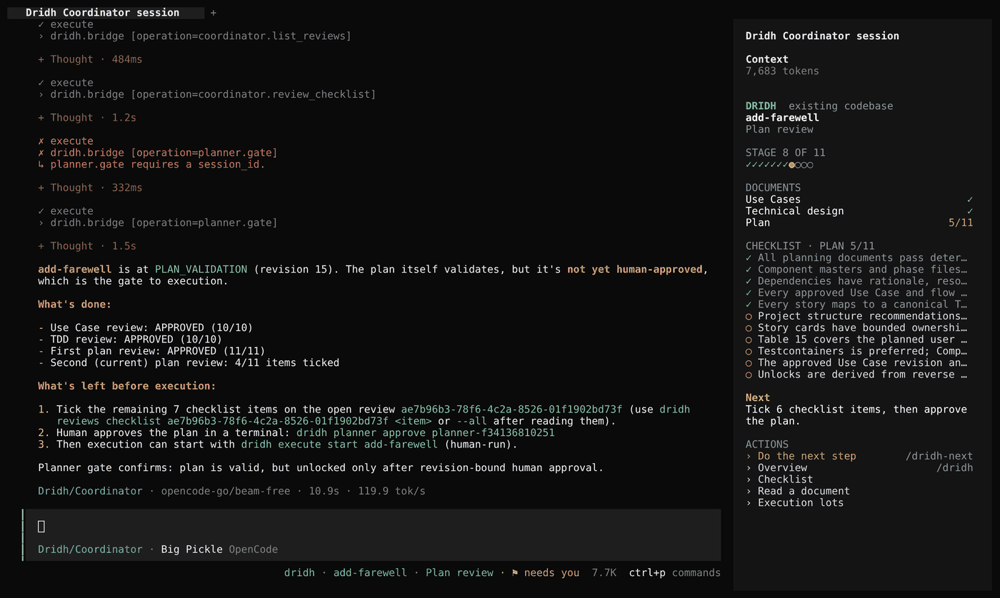
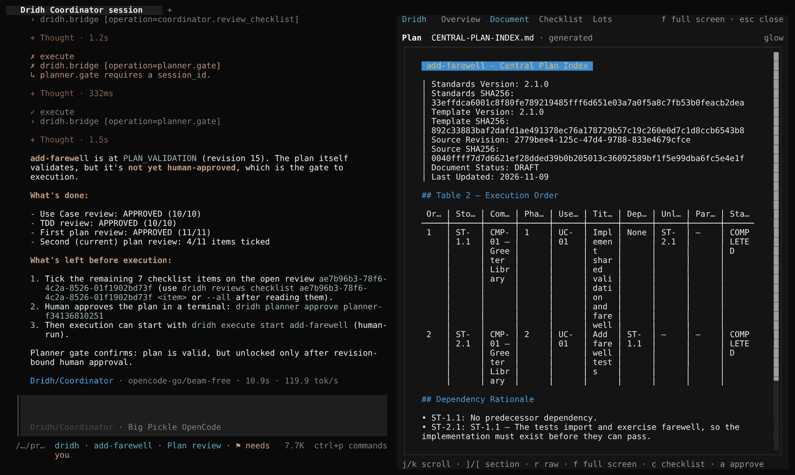

# Dridh (दृढ़)

**Steady hands for AI-built software.**

**Dridh runs a feature through fixed stages inside [OpenCode](https://opencode.ai): use cases, technical design, plan, execution, delivery.** Each stage produces a validated document, and none opens the next stage until **you** approve it.


```bash
# Install Dridh
curl -fsSL https://github.com/rohit5roy/dridh/releases/latest/download/install.sh | bash
```



## The problem

AI coding agents can produce a lot of code quickly, but on real features the work tends to drift:

- **Context is lost.** Requirements, decisions and project knowledge live in a chat window that is small, gets compacted, and is gone in the next session.
- **Output is not checked.** Use cases, designs and plans arrive as prose that nobody validates, so gaps reach the code.
- **The agent approves its own work.** Nothing stops it from declaring a stage finished.
- **Parallel work collides.** Several stories changing one repository at once are hard to coordinate and hard to trace back to the requirement they serve.

Dridh keeps project knowledge in validated documents and a local database outside the model's context, runs every stage in a fixed order, and reserves each approval for a person. It is built to work with models that have small context windows or weaker reasoning: the harness supplies the memory, the next-step guidance and the checks.

## Install

You need **OpenCode 2.2.5 or later** (`npm install -g @opencode/cli@latest`) on Linux or macOS. Then:

```bash
curl -fsSL https://github.com/rohit5roy/dridh/releases/latest/download/install.sh | bash
```

The installer checks everything first and shows its plan, then installs what is missing: the `dridh` command (through
[uv](https://docs.astral.sh/uv/), with Python 3.13), local embeddings for code search (the model comes with the
release, checksum-verified, into `~/.cache/dridh/fastembed`, so it needs no Hugging Face access), and
[glow](https://github.com/charmbracelet/glow) for rendered documents. It adds the Dridh plugin and agents to your
OpenCode configuration, backing up every file it changes, and never changes your default agent. It finishes with
`dridh doctor`. Add `--check` (after `bash -s --`) to see the plan without changing anything.

<details>
<summary>Other ways to install</summary>

- A specific release, including release candidates: `bash install.sh --release v0.7.9` (the default installs the latest stable release)
- From a clone (needs Node.js 24 and npm to build the plugin): `git clone https://github.com/rohit5roy/dridh && cd dridh && ./install.sh`
- Offline: download `dridh-embedding-model.tar.gz` and its `.sha256` from a release, then `bash install.sh --model dridh-embedding-model.tar.gz`; `--no-embeddings` skips code-search embeddings entirely
</details>

## Quick start

Open OpenCode in your project and type `/dridh`. The first time, it asks whether this is a new or an existing
codebase and sets the project up. Then press Shift+Tab until the agent reads Dridh/Coordinator. From a terminal, the same is:

```bash
cd your-project
dridh init --mode existing      # or --mode new for an empty project
dridh start                     # opens OpenCode with the Dridh Coordinator selected
```

Tell the Coordinator what you want to build. It asks questions, writes the documents and stops each time it needs you.
Dridh uses the model OpenCode is set to; to pin one for a project, set `models.provider` and `models.default` in
`.opencode/dridh/dridh.yaml`. Real runs used the free `beam-free` and `big-pickle` models (OpenCode Zen and OpenCode Go).

## How a feature moves


| Stage | What Dridh produces | Your step |
|---|---|---|
| Use Cases | Actors, flows and business rules (`001-USE-CASES.md`) | Tick the checklist, then `dridh ideator approve <session>` |
| Technical design | A validated technical design document | Tick the checklist, then `dridh designer approve <session>` |
| Plan | Central plan, component plans, story cards, test plan | Tick the checklist, then `dridh planner approve <session>` |
| Execution | One Git worktree and branch per story; each story's tests run in their own Docker container (on the host when Docker is missing) | `dridh execute start <feature>`, then a verdict per checkpoint lot (`dridh execute review`) |
| Delivery | Optional stacked pull requests on GitHub (off by default; Dridh never merges) | `dridh feature complete` |

Each approval shows what you are approving and asks you to type a confirmation. If a document changes afterwards, the
approval goes stale and Dridh sends the feature back for review.

## Inside OpenCode

The plugin adds Dridh to OpenCode's terminal interface without modifying OpenCode:

- **Sidebar** (in a session): stage, documents and their reviews, the open checklist, the next step, clickable actions.
- **Panel** beside the conversation: `/dridh` (overview), `/dridh-review [use|tdd|plan]` (document reviewer),
  `/dridh-checklist`, `/dridh-lot` (execution lots with diffs). `f` full screen, `esc` closes it. OpenCode shows either
  its sidebar or a panel, not both.
- **Reviewer**: documents rendered with glow; Mermaid flowcharts, sequence and ER diagrams drawn as text; `r` shows the
  stored source.
- `/dridh-next` does the next human step. Approvals still use the typed confirmation, in Dridh's own terminal prompt.



## Everyday commands

| | |
|---|---|
| Where am I? | `dridh feature status`, `dridh execute status`, `dridh observe` |
| Search your code | `dridh index`, `dridh code search "<query>"`, `dridh code for <story>` |
| Check the setup | `dridh doctor` |
| Safety | `dridh backup`, `dridh restore`, `dridh integrity`, `dridh recovery` |
| Upgrade | run the install command again (or `dridh upgrade` after installing a newer wheel) |
| Remove | `dridh uninstall` (restores your original OpenCode configuration if you have not edited it since) |

Commands print readable text in a terminal and JSON when piped; add `--json` to force JSON.

## Troubleshooting

- **`dridh doctor` fails on OpenCode**: install or upgrade OpenCode to 2.2.5 or later and make sure `opencode` is on PATH.
- **"modified" managed files**: you or another tool edited a Dridh file in the OpenCode configuration; run `dridh upgrade --force` (originals are backed up first).
- **The model stops with a free-tier limit**: start a new session (`dridh start`); Dridh continues from its own saved state.
- **The reviewer shows raw Markdown**: glow is not installed; run the installer again or install glow yourself.

## Licence

Dridh is free software under the [GNU Affero General Public License v3.0](LICENSE) (AGPL-3.0-only): you may use,
study, change and share it, and if you distribute a modified version, or let others use one over a network, you must
publish your changes under the same licence. For use in closed-source products or services, a commercial licence is
available from the copyright holder, Rohit Roy. Contributors accept the [Contributor License Agreement](CLA.md) once.

## Learn more

- [Documentation](docs/README.md) · [Contributing](CONTRIBUTING.md) · [Security](SECURITY.md) · [AGPL-3.0 licence](LICENSE)
