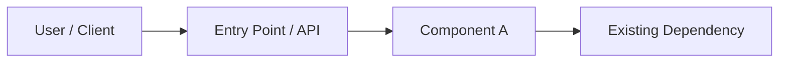
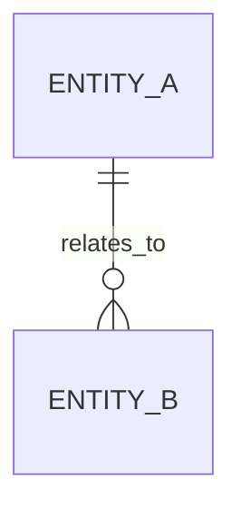

# <FEATURE NAME> — Technical Design Document

> **Standards Version:** 2.1.0  
> **Document Status:** DRAFT  
> **Last Updated:** YYYY-MM-DD  
> **Feature:** <Feature name>  
> **Owner:** <Accountable engineering owner>  
> **Source Use Case Document:** `.opencode/dridh/documents/001-USE-CASES.md`  
> **Source Revision:** <Approved use-case document revision or content hash>

<!--
TEMPLATE AUTHORING CONTRACT — REMOVE THIS COMMENT FROM THE GENERATED TDD.
1. This file is the canonical starting structure for a feature TDD generated by Dridh Technical Designer.
2. The approved 001-USE-CASES.md is the functional source of truth. Do not invent, silently alter, or omit approved requirements.
3. Preserve the main section order and all optional technical overview sections in this template.
4. Replace every <PLACEHOLDER> and every [authoring instruction] with project-specific content.
5. Remove all Notion instructional callout blocks if any are introduced into a future copy of this template. No instructional callout blocks should appear in the generated TDD.
6. Keep the Table 13 header and column order exactly as shown. Keep the Table 11 header and column order exactly as shown.
7. Reference ACT-NN, UC-NN, flow IDs, CMP-NN, DD-N, and other canonical IDs exactly as allocated by the Coordinator. Do not allocate IDs independently.
8. Component definitions are allocated and canonically defined in this TDD during Stage 2 using ### CMP-NN: <Component Name>. Stage 3 COMPONENT-MASTER.md files reference those IDs and MUST NOT redefine them.
9. Retain optional sections even when they do not apply. Mark them N/A and give a brief reason; do not delete them.
10. A generated TDD is not approved because it was generated, validated, or received a positive Jev result. Human approval is recorded through the Dridh review workflow and REVIEW-CHECKLIST.md.
11. Define Stage 2 risk IDs in this TDD using ### Rn: <Risk Title>. A risk first discovered during Stage 3 may be defined in CENTRAL-PLAN-INDEX.md, but every risk must have exactly one canonical definition across the feature.
12. The document generator must strip all HTML comments (including this contract), strip instructional <aside> blocks, and reject output containing unresolved placeholders or template-instruction sentences.
13. Do not place secrets, credentials, tokens, private keys, or sensitive production data in this document.
END TEMPLATE AUTHORING CONTRACT.
-->

## Document Control

### Document Purpose

[State what this TDD specifies, the feature or change it covers, and who should use it. Make the document sufficiently self-contained for engineers and reviewers who have limited prior context.]

### Source of Truth and Baseline

- **Approved requirements:** `001-USE-CASES.md`
- **Requirements status:** <APPROVED / NOT_APPROVED>
- **Requirements revision/hash:** <revision or content hash>
- **Related product/UX documents:** <links or N/A>
- **Related repository/service:** <repository and service/component reference, or N/A>

The approved `001-USE-CASES.md` is the authoritative source for user and business behaviour. This TDD explains how the approved requirements will be implemented. Any proposed change to an approved requirement must be handled through the Dridh deviation process in `LEDGER.md` and the applicable human approval workflow. Do not silently change the use-case baseline in this document.

### Document Status

Use one of the canonical Document Review Status values:

- `DRAFT`
- `READY_FOR_REVIEW`
- `IN_REVIEW`
- `CHANGES_REQUESTED`
- `APPROVED`
- `REJECTED`
- `STALE`

The Coordinator maintains the authoritative review state and approval record in workspace state. This field is a human-readable rendering of that state; it is not itself proof of approval.

## Blocking Reviewers

List the people or roles whose sign-off is required before this design can be approved. Include at least one reviewer with broad architectural/organizational context and the relevant subject-matter experts. Include reviewers from impacted teams where their systems, APIs, data, security controls, operations, or service capacity are affected.

- **Reviewer / Role:** <Name or role> — **Team:** <Team> — **Review responsibility:** <Area> — **Blocking:** <Yes/No> — **Status:** <PENDING / APPROVED / CHANGES_REQUESTED>

For a new service or system, identify the required portfolio/architecture reviewer. Record any required review-triage ticket or process reference here: <reference or N/A>.

## Problem Statement & Resources

### Problem Statement

[Explain why this work is needed, the problem being solved, who experiences it, and the impact on the product, clients, users, or internal teams. Describe the current behaviour and its limitations.]

### Goals and Non-Goals

[Summarise the outcomes this design must achieve and the outcomes it deliberately does not address. Keep this consistent with Scope and Out of Scope below.]

### What I Need from Reviewers

[Highlight decisions requiring reviewer attention, especially irreversible or expensive-to-reverse decisions (one-way-door decisions), security/privacy concerns, significant data-model changes, new services, API compatibility, operational risks, and cross-team dependencies. State the specific feedback or approval needed.]

### Resources

- Product requirements: <link or N/A>
- UX / Figma: <link or N/A>
- Existing technical documentation: <link or N/A>
- Relevant repositories/services: <link or N/A>
- Research, data, incident, or discovery material: <link or N/A>
- Other supporting resources: <link or N/A>

## Definitions

Define project-specific, newly introduced, ambiguous, or overloaded terminology. Use the same terms consistently throughout the TDD and implementation plan.

- **<Term>:** <Definition>.

## Scope

List what this design will deliver. Use numbered items and make each item sufficiently specific to be traced to one or more approved use cases and flows.

1. <In-scope capability or deliverable; reference UC-NN / flow IDs where applicable.>
2. <In-scope capability or deliverable; reference UC-NN / flow IDs where applicable.>

## Out of Scope

List explicitly excluded outcomes and explain why they are excluded when the reason is not obvious. Where applicable, distinguish deferred/future requirements from requirements that are permanently excluded.

1. <Excluded capability> — <reason and future treatment, if any>.

## Target Dates and Milestones

Use known dates only. Dates must use `YYYY-MM-DD`. Do not fabricate dates or silently convert estimates into commitments.

- **TDD ready for review:** YYYY-MM-DD — <Notes or N/A>
- **TDD approval target:** YYYY-MM-DD — <Notes or N/A>
- **Implementation start:** YYYY-MM-DD — <Notes or N/A>
- **Feature preview / beta:** YYYY-MM-DD — <Notes or N/A>
- **Production release:** YYYY-MM-DD — <Notes or N/A>

## Design Summary

[Provide a concise explanation of the proposed solution and its overall architecture. Explain whether this is a change to an existing repository/service, a new component within an existing system, or a new system. Identify where the work will be implemented and why that is the right location. Summarise the major components, their responsibilities, and the high-level interactions.]

## Design Details

### System Context and Architecture

[Describe the system boundary, actors, external systems, internal components, and major interactions. Include a system/context diagram where helpful. State which parts are new and which already exist.]



Replace the illustrative diagram above with the actual architecture or remove the code block if no diagram is useful. Do not leave the example diagram in a completed TDD.

### Component Responsibilities

Define every actionable component during Stage 2 in this TDD. The Coordinator allocates each stable `CMP-NN` ID before document generation. These TDD headings are the canonical component definitions for the feature and must be resolvable during Stage 2 validation, before any Planner-created `COMPONENT-MASTER.md` exists.

Use one heading per component:

```markdown
### CMP-01: <Component Name>
```

For each component definition, explain:

- Component ID and name.
- Existing or new status.
- Responsibility and ownership boundary.
- Owning team/person, when known.
- Inputs, outputs and API/event/data contracts.
- Relevant use cases and flow-step IDs (`SF`, `AF`, `EF`, `BE`, `BR`).
- Dependencies and failure behaviour.
- Data ownership and persistence, where applicable.

Do not invent a component ID or reuse an ID for a different component. In Stage 3, `COMPONENT-MASTER.md` must reference this canonical TDD definition without creating a second `### CMP-NN:` definition heading. A newly discovered component must be routed back through a TDD revision and Coordinator validation.

### Internal and External Data Flow

[Describe the ordered flow of data and control through the system. Cover success, alternate, exception, timeout, retry, and recovery paths where relevant. Identify external boundaries, persistence points, asynchronous messaging, and ownership transitions.]

```mermaid
sequenceDiagram
    participant Actor
    participant Entry
    participant Component
    participant Dependency
    Actor->>Entry: Request / event
    Entry->>Component: Validated input
    Component->>Dependency: Operation
    Dependency-->>Component: Result
    Component-->>Entry: Outcome
    Entry-->>Actor: Response
```

Replace the illustrative sequence with the actual flow or remove it when it is not applicable.

### Use Case-to-Design Traceability Matrix

This matrix is mandatory. It demonstrates how the technical design addresses the approved use-case baseline. Include every approved `UC-NN` at least once and list only the flows genuinely addressed by that row. Use multiple rows when one use case maps to multiple independent components or technical mechanisms.

**Table 13 — Exact canonical header (do not rename, reorder, or add columns):**

| UC ID | Flow IDs | Catering Component(s) | API / Event | Design Decision (DD-N) |
|---|---|---|---|---|
| <UC-NN> | <Flow ID(s) or N/A> | <CMP-NN — Component Name> | <API / event reference or N/A> | <DD-N or N/A> |

Rules:

- Replace the illustrative row with actual approved use-case and flow IDs. Do not retain sample IDs unless they are real IDs in the feature.
- Every approved `UC-NN` must appear in at least one row.
- `Flow IDs` lists the `SF-NN.N`, `AF-NN.N`, `EF-NN.N`, `BE-NN.N`, and/or `BR-NN.N` flow steps covered by the row. Do not use the parent `UC-NN` as a flow ID and do not imply coverage if the design does not address the flow.
- `Catering Component(s)` lists canonical `CMP-NN` IDs and component names.
- `API / Event` lists the API or event name and, where applicable, the section/specification in this TDD. Use `N/A` when no API or event applies.
- `Design Decision (DD-N)` lists relevant feature-level design decision IDs. Use `N/A` when no separate design decision applies.
- Every referenced `DD-N` must have a corresponding `#### DD-N: <Title>` heading in this TDD.
- Every `CMP-NN` reference must resolve to exactly one canonical `### CMP-NN: <Component Name>` definition in this TDD. Stage 3 component masters reference the TDD definition and do not redefine it.
- Any approved use case or flow not addressed by the design is a blocking traceability finding unless its treatment is explicitly authorised and recorded through `LEDGER.md`.

### Data Ownership and Persistence

[Explain which component owns each important data entity, where it is stored, how it is accessed, retention requirements, data lifecycle, consistency guarantees, and deletion or archival behaviour. Reference the Data Model section for detailed schemas.]

### Scalability and Future Evolution

[Explain expected growth, likely bottlenecks, scaling boundaries, capacity assumptions, and how the design can evolve. Include measured or sourced estimates where available; label assumptions clearly.]

## Design Decisions

Record material architectural and technology decisions with stable feature-level `DD-N` identifiers. IDs are allocated by the Coordinator. Component-specific implementation decisions belong in the relevant `COMPONENT-MASTER.md` and use `CDD-N`, not `DD-N`.

Use this exact heading format:

`#### DD-N: <Decision Title>`

For every material decision, include:

- **Context / Problem:** What decision is required and why?
- **Decision:** What are we choosing?
- **Alternatives Considered:** What credible alternatives were evaluated, or why were there none?
- **Rationale:** Why is the selected option appropriate?
- **Consequences / Trade-offs:** What benefits, costs, limitations, and risks follow?
- **Affected Components:** Relevant `CMP-NN` IDs and names.
- **Related Use Cases / Flows:** Relevant `UC-NN` and flow IDs.
- **Reversibility:** State whether this is easy to reverse or a one-way-door decision and explain the implications.
- **Evidence / References:** Relevant benchmarks, standards, experiments, or documentation.

#### DD-1: <Decision Title>

- **Context / Problem:** <Describe the context.>
- **Decision:** <State the selected decision.>
- **Alternatives Considered:** <List alternatives or N/A with reason.>
- **Rationale:** <Explain why this option was selected.>
- **Consequences / Trade-offs:** <Describe positive and negative consequences.>
- **Affected Components:** <CMP-NN references or N/A.>
- **Related Use Cases / Flows:** <UC-NN and flow references or N/A.>
- **Reversibility:** <Reversible / Difficult to reverse / One-way door, with explanation.>
- **Evidence / References:** <References or N/A.>

## Dependencies

Identify dependencies on teams, services, components, infrastructure, vendors, external systems, data producers/consumers, security, operations, and release processes. State the specific work or behaviour required from each dependency. Include impacted teams in Blocking Reviewers when their approval is required.

For each dependency, record:

- **Dependency:** <System, team, service, infrastructure, vendor, data producer/consumer, or process>.
- **Owner / Team:** <Accountable owner>.
- **Required change or commitment:** <Specific work or behaviour required>.
- **Affected components:** <CMP-NN references or N/A>.
- **Required by:** <YYYY-MM-DD or N/A>.
- **Risk if unavailable:** <Impact and mitigation>.

Repeat this structure for every material dependency.

## API Design

If this design creates or changes APIs, document the functional API name and include the OpenAPI specification (or the relevant complete specification content) in this section. Identify versioning, authentication, authorisation, request/response contracts, validation, idempotency, rate limits, error semantics, compatibility, deprecation, and ownership as applicable.

If no API changes apply, retain this heading and write `N/A — <reason>`.

### API Inventory

[Describe the APIs, operations, consumers, and owners. Include names and specification locations.]

### OpenAPI Specification

```yaml
openapi: 3.1.0
info:
  title: <Functional API Name>
  version: <API Version>
paths: {}
```

Replace the illustrative specification with the actual OpenAPI specification. Do not leave an empty specification in a completed TDD. If the API is not applicable, mark the section N/A instead.

## Events

If the design introduces or changes asynchronous/intra-system events, include the AsyncAPI specification and describe producers, consumers, event ownership, delivery guarantees, ordering, idempotency, retries, dead-letter handling, schema evolution, and replay behaviour.

If no event changes apply, retain this heading and write `N/A — <reason>`.

### Event Inventory

[Describe event names, producers, consumers, trigger conditions, and compatibility requirements.]

### AsyncAPI Specification

```yaml
asyncapi: 3.0.0
info:
  title: <Event API Name>
  version: <Version>
channels: {}
operations: {}
```

Replace the illustrative specification with the actual AsyncAPI specification. Do not leave an empty specification in a completed TDD. If events are not applicable, mark the section N/A instead.

## Data Model

Document all persistent data stores, entities, tables/collections, primary keys, indexes, relationships, constraints, expected data types and sizes, retention, archival, deletion, encryption, backup, and recovery. Include entity-relationship diagrams or schemas where useful.

For every important data element, identify its system of record and owning component. Explain data migration and backward compatibility where schemas change.



Replace the illustrative diagram with the actual data model or remove it if not applicable.

## Quality Approach

Describe how the design will be validated and how quality risks will be addressed. Work with the QA Engineer and include measurable acceptance criteria.

### Quality Risks and Assumptions

- **Risk:** <Risk and impact.>
- **Assumption:** <Assumption and how it will be verified.>

### Test Scope

- **In scope:** <Functional, integration, contract, security, performance, resilience, migration, and user-journey coverage as applicable.>
- **Out of scope:** <Explicit exclusions and reasons.>

### Test Strategy

Describe the test levels, tooling, environments, test data, execution order, evidence, and acceptance thresholds.

Dridh testing principles:

1. Prefer real integration testing with actual dependency services; do not introduce mocks as the default testing strategy.
2. Prefer Testcontainers to provision real dependency services for integration tests.
3. Where Testcontainers is unsuitable, use dedicated Docker Compose configuration with a branch/worktree-derived unique project identifier and unique network. Use dynamically allocated host ports to avoid collisions.
4. Where a dependency cannot run locally, use a real QA endpoint/host where available.
5. A WireMock/interface-simulation approach is a documented last-resort exception only when neither real Docker/Testcontainers dependencies nor a real QA endpoint can be used. Base the simulation on an authoritative interface contract (for example, OpenAPI) and document the reason.
6. Include user-journey tests derived from approved use cases and their success, alternative, exception, and boundary flows.
7. Define how tests run in CI and locally, how test evidence is retained, and what blocks story completion.
8. Identify pre-existing mocking usage separately from newly introduced mocking usage. New prohibited mock additions must be repaired through the bounded Executor repair loop; historical usage must not be treated as a new violation without diff evidence.

### Environments and Test Data

[Identify local, containerised, QA, staging and production-like environments. Describe data setup, anonymisation, synthetic data boundaries, access controls and cleanup.]

### Route to Release

[Describe test gates, release criteria, required approvals, rollout verification and post-release checks.]

## Well-Architected Considerations

### Cost Considerations

Estimate the cost impact of the proposed change. Include the assumptions used, expected workload, compute, storage, network/data transfer, logging/monitoring, third-party services, and relevant QA and production environments. Identify material cost changes and any required FinOps engagement.

If no material cost change is expected, explain why and identify the assumptions supporting that conclusion.

### Security & Privacy Considerations

Identify security and privacy risks in the design, application, infrastructure, data handling, and operational environment. Explain prevention, detection, mitigation, and recovery controls.

Address as applicable:

- Authentication and authorisation.
- Least privilege and service-to-service trust.
- Secrets and credential handling.
- Encryption in transit and at rest.
- PII and sensitive data processing, minimisation and retention.
- Auditability and security logging.
- Input validation, injection, SSRF and other relevant application risks.
- Dependency and supply-chain risks.
- Network boundaries and infrastructure security.
- Threat modelling and abuse cases.
- Security testing and vulnerability remediation.
- Incident response and access revocation.

State explicitly when a control is not applicable and why.

## Expected Level of Effort

Provide an implementation estimate and explain the major work packages, assumptions, complexity, sequencing constraints, external dependencies, and areas of uncertainty. Distinguish engineering effort from calendar duration. Do not provide false precision when the scope or dependencies are not yet known.

For each major work area, provide:

- **Work area:** <Work package>.
- **Estimate:** <Person-days/weeks or range>.
- **Complexity:** <Low / Medium / High>.
- **Dependencies / assumptions:** <Relevant constraints>.

Repeat for the major work packages. Distinguish engineering effort from calendar duration.

## Open Questions And Assumptions

Record unresolved questions and assumptions. Do not fabricate answers. An unanswered material question must remain `OPEN` and its impact must be visible. Questions that change an approved requirement must be reviewed by the Coordinator to determine whether new approval or a Ledger entry is required.

**Table 11 — Exact canonical header (do not rename, reorder, or add columns):**

| # | Question | Asked In | Answer | Source | Impact |
|---|---|---|---|---|---|
| — | — | — | — | — | — |

Rules:

- `#` is a sequential integer beginning at 1 within this document.
- `Question` records the question without changing its meaning.
- `Asked In` identifies the stage, section, agent, or session where it arose.
- `Answer` contains the agreed answer, `OPEN`, or `N/A` with a reason.
- `Source` identifies the human, document, system, or evidence that supplied the answer.
- `Impact` explains what the answer changes, or `None` if there is no impact.
- Replace the all-dash row with actual questions, or retain it only when there are no open questions.

## OPTIONAL — Technical Overview Supporting Sections

Retain every optional section below in generated TDDs. If a section does not apply, write `N/A — <brief reason>` rather than deleting the heading. Promote an optional section into the main body only if doing so materially improves clarity; if moved, preserve a clear location and do not create duplicate conflicting content.

## Technical Justifications / Alternative Designs

[Compare credible design alternatives, such as database choices, messaging patterns, libraries, deployment approaches, service boundaries, or third-party products. Explain the decision criteria and why the selected option is appropriate. Link the relevant `DD-N` decision.]

## Integration/Migration Plan

Describe how the change integrates with existing systems and how data, traffic, configuration, contracts, and responsibilities move from the current state to the target state.

Include, where applicable:

- Migration sequence and ordering constraints.
- Backward/forward compatibility.
- Data migration, backfill and reconciliation.
- Dual-read/dual-write behaviour and duration.
- Deployment sequencing across services/teams.
- Feature enablement and client impact.
- Validation of migrated data and functionality.
- Decommissioning or removal of legacy behaviour.
- Communication and operational readiness.

## Rollback Plan

Explain how the system returns to a safe state if deployment, migration, integration, or production operation fails.

Cover:

- Rollback triggers and decision owner.
- Application/configuration rollback steps.
- Data restoration, repair, or forward-fix strategy.
- Dual-write or data divergence handling.
- Compatibility with old and new versions.
- Feature-flag disablement, where applicable.
- Recovery validation and communication.

## Feature Flags

List any feature flags introduced by this design. Include default values, owner, target environments, rollout strategy, kill-switch behaviour, dependencies, and removal criteria.

For each flag, record:

- **Flag:** `<FLAG_NAME>`.
- **Purpose:** <Capability or risk controlled>.
- **Default:** <ON/OFF>.
- **Environment / Audience:** <Rollout scope>.
- **Owner:** <Accountable owner>.
- **Removal criteria:** <When and how the flag will be removed>.

Repeat for each feature flag.

If no feature flags are required, write `N/A — <reason>`.

## Feature/Service Logic

Provide a detailed walkthrough of important business or technical logic. Treat APIs and data models as the ingredients and this section as the execution recipe.

Include:

- Trigger and preconditions.
- Ordered processing steps.
- Validation and decision points.
- State changes and persistence operations.
- Events or downstream calls.
- Idempotency and concurrency behaviour.
- Success, alternate and failure outcomes.
- Retry, compensation and recovery paths.

Use pseudocode or sequence/activity diagrams where they make the logic clearer.

## Scaling Estimate

Estimate expected throughput, concurrency, data volumes, processing times, peak periods and growth. Include average load, normal peak, absolute peak, expected growth horizon, and the target scaling factor where relevant. State where estimates came from and which numbers remain assumptions.

For each relevant metric, provide:

- **Metric:** <Requests/events per second, daily transactions, stored data, processing latency, concurrency, or other relevant measure>.
- **Current / baseline:** <Value or unknown>.
- **Expected peak:** <Value or unknown>.
- **Growth assumption:** <Assumption and horizon>.
- **Evidence / source:** <Source or unknown>.

Repeat for every material capacity dimension.

If the design has no meaningful scale dimension, explain why.

## Monitoring & Alerting

Identify operational signals, dashboards, alerts, thresholds, owners and response actions. Include availability, latency, error rates, saturation, queue depth/age, database health, dependency health, business-level outcomes, and security events where relevant.

For each critical alert, state:

- Signal and measurement.
- Threshold or detection condition.
- Severity.
- Notification/owner.
- Runbook or response action.
- Recovery/clear condition.

## Failure Scenarios And Recovery

Assume each major component and dependency can fail. Document the outcome, detection, containment, mitigation, recovery, and data-repair/backfill requirements.

For each material failure scenario, record:

- **Failure scenario:** <What can fail>.
- **User / system impact:** <Effect and severity>.
- **Detection:** <Signal, alert or observable symptom>.
- **Mitigation / recovery:** <Containment and recovery steps>.
- **Data repair / backfill:** <Required repair or N/A with reason>.
- **Owner:** <Accountable team or role>.

Include upstream bad data, downstream unavailability, partial processing, duplicate delivery, timeout, database failure, deployment failure, and full service outage where applicable.

## Risks

Record material technical, delivery, operational, security, privacy, data, dependency and adoption risks. Risk IDs use the canonical `R` followed by a number (for example, `R1`). The Technical Designer allocates and defines risks first identified during Stage 2 in this TDD, so Stage 2 validation never depends on the later Stage 3 `CENTRAL-PLAN-INDEX.md`.

Use one heading per Stage 2 risk:

```markdown
### R1: <Risk Title>

- **Likelihood:** <Declared scale value>
- **Impact:** <Declared scale value>
- **Risk:** <What may happen and why>
- **Mitigation:** <Prevention, detection, containment or recovery>
- **Owner:** <Role/person or N/A with explanation>
- **Related Components:** <CMP-NN references or N/A>
- **Related Use Cases / Flows:** <UC-NN and flow IDs or N/A>
```

The Planner projects these canonical risk IDs into Table 9 of `CENTRAL-PLAN-INDEX.md`; it does not create duplicate definitions. If a genuinely new risk is first identified during Stage 3, the Planner may define that risk in `CENTRAL-PLAN-INDEX.md`. Across the feature, each risk ID must have exactly one canonical definition. The Coordinator validates the definition location according to the stage in which the risk was first introduced.

Do not create a second independent Table 9 register in the TDD; use the structured risk headings above as definitions and the Central Plan Table 9 as the planning register/projection.

## Acceptance Criteria

Define measurable, verifiable conditions for the design and feature to be considered complete. Criteria must be traceable to approved use cases, flows, components, APIs/events, data, security, operations and testing as applicable.

Use stable references where relevant (`UC-NN`, flow IDs, `CMP-NN`, `DD-N`, and test phase IDs). Do not use acceptance criteria to silently change the approved requirements.

- [ ] <Criterion with a measurable pass condition and relevant IDs.>
- [ ] <Criterion with a measurable pass condition and relevant IDs.>

## AI Systems

Complete this section for any production ML/AI system introduced or materially changed by the feature. If the feature does not introduce or materially change a production ML/AI system, retain this section and write `N/A — This feature does not introduce or materially change a production ML/AI system.`

### Section 1: Purpose & Accountability

#### 1.1 AI System Type

Identify the type of AI system:

- **Internal trained model:** training or fine-tuning an internally developed model or a third-party model that has been further fine-tuned.
- **Third-party model:** using a pre-trained third-party generative or predictive model, for example an LLM accessed through an API.

Describe the specific model(s), provider, version, deployment location, intended use, and whether the required Engineering approval has been obtained. Do not leave generic model examples as the system description.

#### 1.2 Risk Tier Assessment

Assess the system's risk tier and document the justification and approvals. The source governance guidance identifies the following categories for assessment:

- **High Risk:** systems affecting what consumers see (for example ranking, filtering or moderation), making decisions about people (for example fraud detection, bans or authentication), or using biometric data.
- **Limited Risk:** systems where consumers see AI-generated content, such as summaries, chatbots or recommendations, and transparency disclosures may be required.
- **Minimal Risk:** internal-only systems with no consumer impact, such as internal analytics or backend classification.
- **Unacceptable Risk:** prohibited categories identified by the applicable AI governance policy, including subliminal manipulation, exploitation of vulnerabilities, social scoring, specified biometric categorisation or surveillance practices, and specified emotion-recognition use in workplace or education settings. Escalate potential unacceptable-risk use cases to the designated AI Governance channel before proceeding.

**Assessment:** <High / Limited / Minimal / Unacceptable / Pending>  
**Justification:** <Reasoning based on intended use and impact>  
**Approvals / Governance Reference:** <Evidence or Pending>

Do not treat this template's summary as a substitute for current legal or internal policy review. Follow the organisation's applicable AI governance process.

#### 1.3 Primary Purpose

[Describe the goal, problem solved, intended benefits, users affected, and operational context.]

#### 1.4 Accountable Owner

[Identify one accountable owner for the AI system lifecycle.]

### Section 2: Risk & Impact

#### 2.1 Primary Risks

[Describe failure, misuse and model risks, including misleading output, harmful or inappropriate content, incorrect recommendations, unfair decisions, automation bias, over-reliance, and impact on individuals or customers as applicable.]

#### 2.2 Risk Mitigation

[Describe technical, operational and governance controls that reduce the identified risks.]

### Section 3: Data & Privacy

#### 3.1 Data Sources

[Identify data sources, original collection purpose, permitted AI use, provenance, quality controls, preparation, retention and deletion.]

#### 3.2 PII Handling

[Describe whether personal or sensitive data is processed, minimisation, masking/tokenisation, access, encryption, retention, deletion and provider handling. State explicitly if no PII is used and how that was verified.]

### Section 4: Bias, Fairness & Safety

#### 4.1 Potential Issues

[Identify likely sources of bias, unsafe outputs, misuse, prompt injection, data poisoning, security and other safety risks relevant to the system.]

#### 4.2 Mitigation Steps

[Describe guardrails, content controls, human oversight, fairness evaluation, adversarial testing, access control and escalation procedures.]

### Section 5: Performance & Evaluation

#### 5.1 Pre-deployment Evaluation

[Define evaluation datasets, scenarios, metrics, acceptance thresholds and review evidence.]

#### 5.2 Production Monitoring

[Describe production quality monitoring, drift, fairness/safety monitoring, incident thresholds, alert owners and response procedures.]

#### 5.3 Update Process

[Describe model/provider/version changes, evaluation, approval, deployment, rollback and triggers for retraining or reconfiguration.]

## TDD Completion Checklist

This checklist is a self-check for the document generator and author. The authoritative human review checklist must be generated separately as `REVIEW-CHECKLIST.md` by the Dridh review workflow, using the actual feature content and validation results.

- [ ] The problem statement and scope are consistent with the approved use cases.
- [ ] All approved use cases are represented in Table 13.
- [ ] All referenced flows are genuinely addressed by the design.
- [ ] Every referenced component uses its Coordinator-allocated `CMP-NN` ID.
- [ ] Every referenced `DD-N` has a corresponding decision heading.
- [ ] Every Stage 2 risk ID has one canonical `### Rn:` definition in this TDD.
- [ ] API and event contracts are included where applicable, or explicitly marked N/A.
- [ ] Data ownership, persistence and migration impacts are addressed.
- [ ] Quality risks and test strategy are documented.
- [ ] No-mocks and Testcontainers-first requirements are addressed where relevant.
- [ ] Cost, security, privacy and operational implications are addressed.
- [ ] Optional sections are retained and marked N/A where unused.
- [ ] AI Systems is completed or explicitly marked N/A with reason.
- [ ] Table 11 uses the exact canonical header and unresolved questions remain visible.
- [ ] All IDs and cross-references resolve under `TABLE-STANDARDS.md`.
- [ ] No HTML comment, instructional Notion callout, known template-instruction sentence, or unresolved placeholder remains in the generated TDD.
- [ ] The TDD is ready for deterministic validation and subsequent human review.

## Document References

List the important source documents and evidence used to develop this design. Include revision, date or content hash where available.

- Approved use cases: `001-USE-CASES.md` — <revision/hash>
- Canonical table and document standards: `TABLE-STANDARDS.md` — Version 2.1.0
- Product requirements: <reference or N/A>
- UX/design resources: <reference or N/A>
- Existing architecture/API/event documentation: <reference or N/A>
- Other evidence: <reference or N/A>
